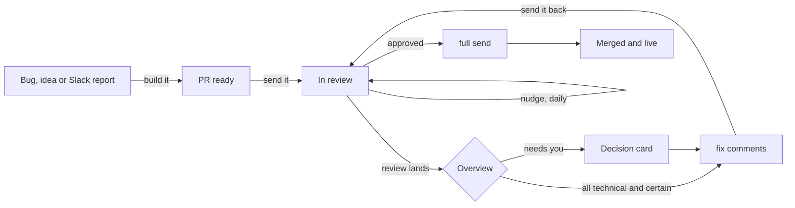
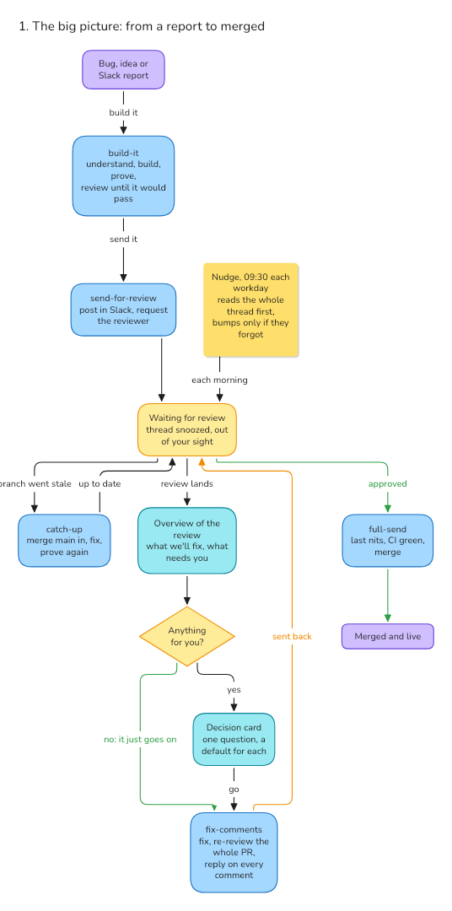

# Agent skills

The skills we use at [Alice](https://alice.tech) to take work from a bug report to a merged PR with coding agents ([Claude Code](https://claude.com/claude-code) and [Codex](https://openai.com/codex)), driven by short voice commands: "build it", "send it", "fix comments", "full send".

They're written for our repo (Alicia), our Slack and our Linear, and they're public so others can borrow from them. Take what's useful; the parts that are ours are listed under [Making them yours](#making-them-yours).

## What you say

| Say | Skill | What happens |
|---|---|---|
| "build it", "fix it", "take this" | [`build-it`](skills/build-it/SKILL.md) | Takes a bug or feature from wherever it starts (your words, a Linear issue, a Slack report) to a PR that's ready for review: finds the cause, designs, builds, tests, reviews, opens the PR. |
| "send for review", "send it" | [`send-for-review`](skills/send-for-review/SKILL.md) | Posts the PR in the review channel, requests the reviewer, and sets up a daily nudge that reads the thread before bumping anyone. |
| "review's back", "what did they say" | [`fix-comments`](skills/fix-comments/SKILL.md) | An overview of the review that came back: what we'll fix and what needs you, with confidence, in two tables. Nothing changed yet. |
| "fix comments" | [`fix-comments`](skills/fix-comments/SKILL.md) | The same overview, then fixes what's right (without asking when it's all technical and certain), asks you the product calls, re-reviews the whole PR, replies on every comment, and sends it back. |
| "full send" | [`full-send`](skills/full-send/SKILL.md) | Takes an approved PR the rest of the way: last comments, conflicts, CI, merge, and checks it's live. |
| "catch up" | [`catch-up`](skills/catch-up/SKILL.md) | Brings a stale branch up to date: merges the base in, resolves conflicts, and proves it still works. |
| "review this", "another look" | [`review-pr`](skills/review-pr/SKILL.md) | Reviews a teammate's PR with Claude and Codex, explains it in plain words, and posts the review on GitHub and in Slack. |
| "review loop" | [`review-loop`](skills/review-loop/SKILL.md) | Claude and Codex review a change in rounds until they agree. The other skills run it. |
| "council" | [`council`](skills/council/SKILL.md) | Four models review instead of two, for changes that deserve it. |
| "usability", "fix it with usability" | [`usability`](skills/usability/SKILL.md) | Judges a screen like a senior product designer, by *Don't Make Me Think* first, and fixes what a student would trip on in one pass, with before and after screenshots. Its principles are also what reviews judge UI by. |
| "student test" | [`student-test`](skills/student-test/SKILL.md) | A panel of agents, each playing a student, tries a screen, a flow or some wording. |
| "babysit" | [`babysit-pr`](skills/babysit-pr/SKILL.md) | Watches a PR through CI and review bots, fixing what's real, until it's green. |
| (automatic) | [`linear-track`](skills/linear-track/SKILL.md) | Keeps the thread's Linear issue in step with the work. |
| "sync Linear" | [`linear-sweep`](skills/linear-sweep/SKILL.md) | Audits your Linear board against GitHub and fixes what drifted. |
| "grill me" | [`grill-me`](skills/grill-me/SKILL.md), [`grilling`](skills/grilling/SKILL.md) | Interviews you about a plan or design in rounds, each question with a recommended answer, until nothing is left assumed. |

## How they fit together



`review-loop` runs inside `build-it`, `fix-comments`, `full-send` and `review-pr`. `babysit-pr` runs inside `full-send`.

### See inside each skill

The big picture is below. [Open all the diagrams in Excalidraw](https://link.excalidraw.com/l/9GDlHwpjNWo/6CBVjVY4H8K) to see inside every skill, in sections: the commands you say for the PR flow, the ones you use on their own, the skills only other skills run, and the shared rules in `pr-flow/`.



#### Keeping them up to date

When a skill changes how it works, change its diagram in the same commit. Each diagram's boxes and arrows are in [`docs/diagrams/skills.py`](docs/diagrams/skills.py), and [`excalidraw.py`](docs/diagrams/excalidraw.py) draws them in the shared scene ([edit it here](https://app.excalidraw.com/s/9GDlHwpjNWo/6CBVjVY4H8K), if you're in our Excalidraw workspace). Then:

```sh
export EXCALIDRAW_API_KEY=...   # an Excalidraw+ API key
python3 docs/diagrams/excalidraw.py draw grill 150 6350 <diagram id>   # redraws it in place (ids: get_diagram)
python3 docs/diagrams/excalidraw.py fonts         # every text should be font 6 (Nunito)
python3 docs/diagrams/excalidraw.py shot docs/big-picture.png 100 150 1050 1960   # after a change to the big picture
```

With the Excalidraw MCP connected, an agent can do the same: ask it to redraw a skill's diagram from `skills.py`. Outside our workspace, draw them in a scene of your own and change `SCENE` in `excalidraw.py`.

## The ideas behind them

The shared rules live in [`pr-flow/`](pr-flow), and every skill points at them rather than repeating them.

- **One question per command** ([decision-card.md](pr-flow/decision-card.md)). Each command asks you at most once: one card with every choice that's yours, each with a recommended default, so "go" accepts the lot.
- **Who decides.** Product and UI/UX decisions are yours, asked as a ten-second tldr. Purely technical ones are the agents', settled by the repo's docs and the technology's own docs, looked up each time. You only hear about technical work when it's gone hairy and dropping a requirement would make it simpler.
- **The right way, the first time** ([lenses.md](pr-flow/lenses.md)). A change leaves the code it touches in the shape it should have. Old debt is no excuse for new debt, and "follow-up PR" isn't a way to skip the work.
- **Two reviewers who have to agree** ([review-loop](skills/review-loop/SKILL.md)). Claude and Codex review independently through the same lenses (Spec, Correctness, Standards, Backend, UI and UX), then argue it out.
- **Overviews you can read at a glance** ([overview.md](pr-flow/overview.md)). A review is one bold line, your table, then ours, with confidence and the evidence behind it.
- **Proof, not claims** ([ready.md](pr-flow/ready.md)). A PR is ready when its checks pass and the change has been seen working in the app.
- **Out of sight while waiting** ([waiting.md](pr-flow/waiting.md), [nudge.md](pr-flow/nudge.md)). In [T3 Code](https://github.com/pingdotgg/t3code), a thread snoozes while it waits on someone else, and comes back when there's something for you.

## Install

```sh
git clone https://github.com/alice-edu/agent-skills.git
./agent-skills/install.sh
```

The installer links each skill into `~/.agents/skills` (Codex) and `~/.claude/skills` (Claude Code), and the shared rules into `~/.agents/pr-flow`, from your checkout. It asks for your name, Slack member ID and GitHub login once and writes them to `pr-flow/me.md`, which stays out of git. Anything already at those paths is moved to `~/.agents/backup-<time>/`.

Update with `git pull`: the links point at the checkout, so there's nothing to reinstall. Run `install.sh` again when a skill is added.

### What they need

- [`gh`](https://cli.github.com), signed in.
- The Slack and Linear connectors in Claude Code.
- Codex, for the second reviewer.
- Optional: the Excalidraw MCP for diagrams, and T3 Code for snoozing threads and the scheduled nudge. Without T3 Code those steps are skipped.

## Making them yours

What's specific to us, and where to change it:

- **Slack**: the review channel is `#pr-review-channel` (`pr-flow/slack.md`, `send-for-review`).
- **Linear**: the team key is `ALI` (`linear-track`, `linear-sweep`).
- **The repo's docs**: the skills read our `AGENTS.md` and `docs/backend-review.md`. Point them at your own: the lenses look for "the repo's backend review doc", so any repo with one works.
- **Models**: `review-loop` and `council` name the Claude and Codex models we use.

## Credits

[`grilling`](skills/grilling/SKILL.md) and [`grill-me`](skills/grill-me/SKILL.md) are by Matt Pocock, from [mattpocock/skills](https://github.com/mattpocock/skills), MIT ([license](skills/grilling/LICENSE)). Our `grilling` leaves "with a fresh context window" out of its subagent line.

[`pr-wait`](skills/babysit-pr/scripts/pr-wait) is by Theo Browne, MIT ([license](skills/babysit-pr/scripts/LICENSE-pr-wait)).
